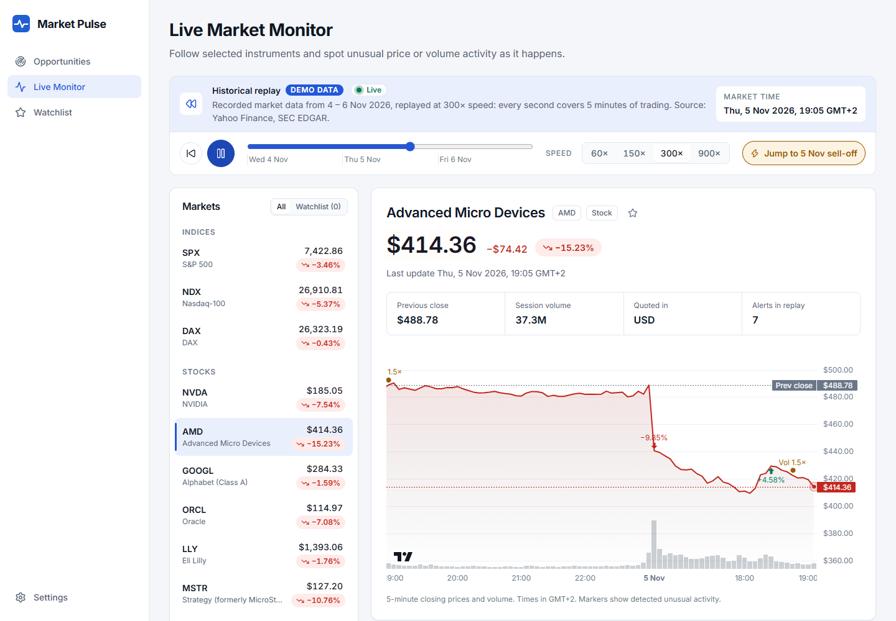
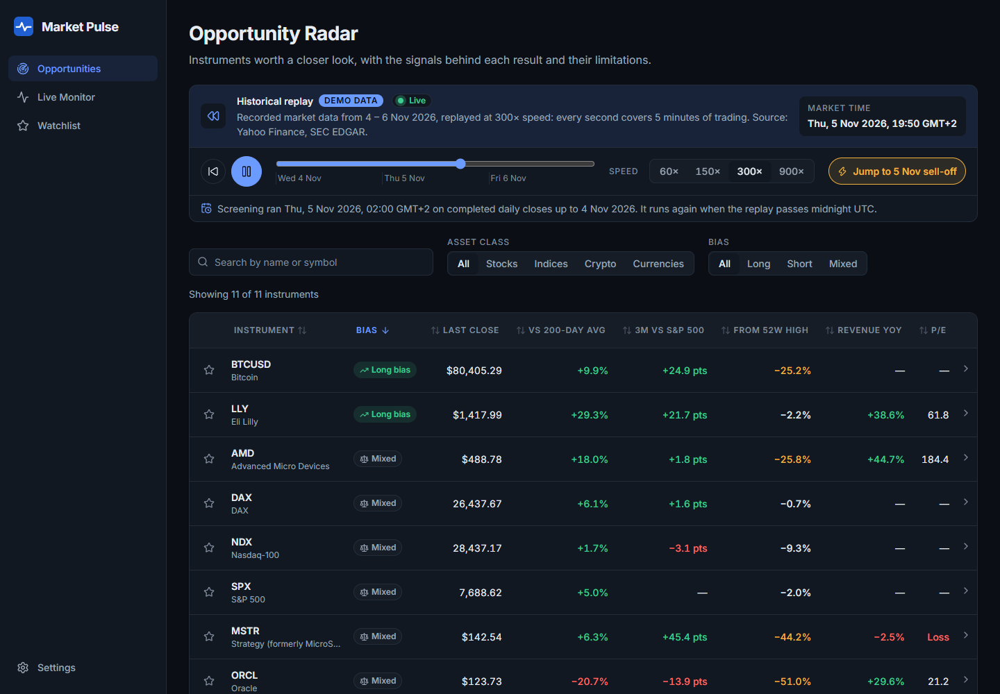
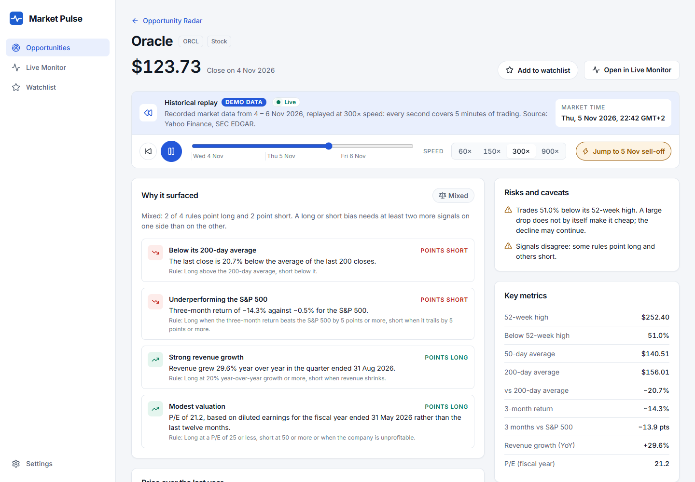

# Market Pulse

[](https://github.com/meltsas/market-pulse/actions/workflows/ci.yml)

**Discover investment opportunities. Understand unusual market activity.**

Market Pulse is a market intelligence dashboard built with React and TypeScript. It combines research-oriented screening with live market monitoring to show individual investors **what deserves a closer look, and why**. A local mock API replays three days of market data, including the 5 November 2026 sell-off, so the whole app runs without paid data or API keys.

This is a personal software project, not a trading platform or investment advice.



## Features

- **Live Market Monitor:** instruments with prices that update as the replay runs, a price and volume chart with alert markers, and a feed of unusual activity that explains the rule behind each alert. Connection loss and recovery are visible and handled without losing data.
- **Opportunity Radar:** a sortable, filterable screening of every instrument with a long, short, or mixed bias. Each result explains which rules point which way, lists risks and missing data, shows how fresh the data is, and charts a year of prices with 50- and 200-day averages.
- **Watchlist:** star instruments anywhere in the app, review them on their own page, and follow them in Live Monitor.
- **Replay controls:** every page with market data clearly labels it as a replay and lets you pause, move through the recorded days, change the speed, or jump to the sell-off.
- **Settings:** light, dark, or system theme.

| Opportunity Radar                                                    | Instrument detail                                                |
| -------------------------------------------------------------------- | ---------------------------------------------------------------- |
|  |  |

## How it's built

| Area               | Technology                                 |
| ------------------ | ------------------------------------------ |
| Frontend           | React 19, TypeScript, Vite                 |
| Routing            | React Router                               |
| State and API data | Redux Toolkit, RTK Query                   |
| Live updates       | Server-Sent Events (SSE)                   |
| Charts             | TradingView Lightweight Charts             |
| Styling            | SCSS Modules, design tokens, Inter, Lucide |
| Runtime validation | Zod                                        |
| Testing            | Vitest, React Testing Library              |
| Mock API           | Node.js 24 with native TypeScript, Fastify |

Some of the decisions behind it:

- **One set of contracts.** Zod schemas in `src/contracts/` type the mock API and validate every REST response and stream event in the UI, so invalid data becomes a visible error state instead of a crash.
- **Live data without lost or stale updates.** One SSE connection serves the whole app. After it opens, cached data is refetched, events that arrive meanwhile are queued and applied afterwards, and no event can move cached data back in time. The connection reconnects with backoff and notices a stalled stream through a heartbeat.
- **Explainable, honest signals.** Every alert and screening result states its rule and thresholds. The screening only uses closes and company reports that existed at the time, and it shows missing data instead of guessing.
- **Focused rendering.** Components subscribe to their own part of the RTK Query cache, and charts append new points instead of redrawing.
- **Accessible, responsive UI.** Semantic HTML, keyboard-operable controls, visible focus, live regions for alerts, reduced-motion support, and layouts that switch to cards and single views on small screens.
- **Small first load.** Chart pages load on demand, and React ships in its own long-cached chunk.
- **Checked on every push.** Strict TypeScript, type-aware ESLint, Prettier, the test suites, and a production build run in GitHub Actions.

The project is developed with AI assistance (Claude Code). [`AGENTS.md`](AGENTS.md) sets the rules the agents follow, such as strict typing, tests for behavior changes, and no unrequested dependencies, and every change is reviewed before it is committed.

## Running locally

**Requirements:** Node.js 24.16 or newer. `npm install` stops early on older versions.

```bash
npm install
npm run mock-server:record-prices   # optional: records the real prices, takes about 15 seconds
npm run dev
```

`npm run dev` starts the mock API and the UI together; Ctrl+C stops both. Open the URL that Vite prints. Without recorded prices, the mock API generates synthetic prices and the app labels them as such; real prices can be recorded until about early January 2027 (see [docs/mock-api.md](docs/mock-api.md)).

### A two-minute tour

1. Open **Live Monitor** and select **Jump to 5 Nov sell-off** in the replay panel.
2. Watch the US open: prices drop, alerts explain each move, and the chart marks them.
3. Pause the replay, switch to **Opportunity Radar**, and filter by bias. The pause shows on every page.
4. Open **ORCL** to see how a falling price and a cheap, growing company produce a mixed bias.
5. Star a few instruments and follow them from **Watchlist** in Live Monitor.

### Scripts

| Command                                   | Purpose                                                                  |
| ----------------------------------------- | ------------------------------------------------------------------------ |
| `npm run dev`                             | Start the mock API and the UI                                            |
| `npm run dev:ui` / `npm run mock-server`  | Start only the UI, or only the mock API (port 4000, restarts on changes) |
| `npm run typecheck` / `npm run lint`      | TypeScript project check / ESLint with type-aware rules                  |
| `npm run format` / `npm run format:check` | Format with Prettier, or only check                                      |
| `npm test` / `npm run test:watch`         | Run the tests once, or in watch mode                                     |
| `npm run build` / `npm run preview`       | Type-check and build into `dist/`, or serve that build                   |
| `npm run mock-server:record-prices`       | Record the replayed prices from Yahoo Finance into a gitignored folder   |
| `npm run mock-server:record-fundamentals` | Refresh the committed SEC fundamentals; needs `SEC_USER_AGENT` in `.env` |

The mock API's endpoints, replay, alert and screening rules, and data sources are described in [docs/mock-api.md](docs/mock-api.md).

## Project structure

```text
src/
  app/         Routing, layout, and the Redux store
  api/         RTK Query endpoints
  contracts/   Zod schemas shared with the mock API
  features/    live-monitor, opportunities, watchlist, replay, market-stream, settings
  components/  Shared UI components
mock-server/   Fastify mock API: replay clock, alert detection, and screening
docs/          Roadmap and mock API reference
```

## Data and licensing

- Prices recorded from Yahoo Finance stay on your machine; Yahoo's terms do not allow redistribution. The screenshots show a short excerpt of that data.
- SEC EDGAR fundamentals are public and committed to the repository.
- Charts use [TradingView Lightweight Charts™](https://www.tradingview.com/lightweight-charts/) (Apache License 2.0), Copyright © TradingView, Inc. As its license requires, every chart shows the TradingView attribution logo, which links to <https://www.tradingview.com/>.
- `npm audit` reports a regular-expression denial-of-service advisory in `picomatch`, which Vite and typescript-eslint use at build time. No patched version exists yet, and it is not part of the app that runs in the browser.

## Roadmap

[docs/ROADMAP.md](docs/ROADMAP.md) lists the completed phases and what comes next, such as a private backend with real market data.

## License

[MIT](LICENSE)

Market Pulse is for experimentation, education, and independent research. Market signals are not investment advice or guarantees of future performance.
